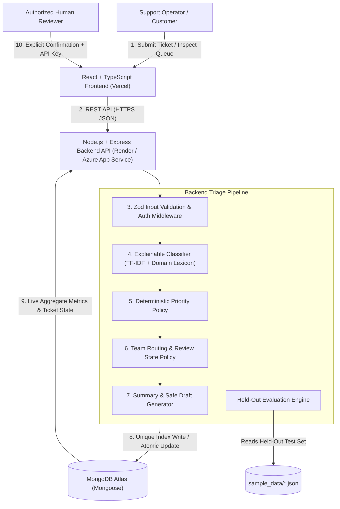

# System Architecture — PS04: Azure Support Ticket Automation

## 1. Architectural Overview

The **Azure Support Ticket Automation** platform is a modular full-stack TypeScript application designed to assist enterprise support teams with incoming ticket triage while preserving strict **human-in-the-loop governance**.

The system accepts customer support tickets (`ticketId` and `message`), normalizes and analyzes the text using an explainable hybrid TF-IDF and domain-lexicon classifier, evaluates urgency and operational impact using a separate deterministic priority policy, routes the ticket to the appropriate specialist queue, generates a concise summary and safe draft response, and persists the complete record in **MongoDB Atlas**.

Crucially, the system **never automatically sends emails or customer messages**, and **never marks a draft response as approved without explicit authorization and confirmation from a human reviewer**.

---

## 2. End-to-End Request Flow

1. **User submits a ticket through the frontend**: A support operator or user submits a `ticketId` and `message` via the React + TypeScript dashboard (`POST /api/tickets`).
2. **Frontend sends a request to the backend**: The centralized API client (`frontend/src/services/api.ts`) dispatches a JSON request to the Express.js API configured via `VITE_API_BASE_URL`.
3. **Backend validates the input**: `validateMiddleware.ts` (powered by Zod) validates `ticketId` format (`3–40` alphanumeric/hyphen/underscore characters) and `message` length (`5–5000` non-empty characters). Malformed JSON or invalid payloads are immediately rejected with `HTTP 400`.
4. **Classification service predicts a category**: `classifierService.ts` normalizes the input text, evaluates weighted domain phrases alongside TF-IDF cosine similarity trained on the development corpus (`development_tickets.json`), and outputs a predicted category (`Billing`, `Technical`, `Access`, or `General`), a confidence proxy (`0.15–0.98`), matched signals, and an uncertainty flag (`isUncertain`).
5. **Priority service evaluates urgency and impact**: `priorityService.ts` independently inspects operational impact, corroborated service outage scope, affected user counts, security compromise indicators, and explicit deadlines to assign `Low`, `Medium`, `High`, or `Critical` priority.
6. **Routing service assigns a support team**: `routingService.ts` maps the category to its specialist queue (`Billing Support`, `Technical Support`, `Identity and Access Support`, or `General Support`) and assigns the initial review state (`pending_review` for confident predictions, or `needs_review` when `isUncertain` is true).
7. **Summary and draft response are generated**: `draftService.ts` creates a concise issue summary and a safe, non-committal draft response tailored to the category, priority, and uncertainty status.
8. **MongoDB stores the ticket**: `TicketModel` (`backend/src/models/Ticket.ts`) persists the document in MongoDB Atlas. A database-level unique index on `ticketId` guarantees that duplicate or concurrent submissions with the same ID fail with `E11000` and return `HTTP 409 Conflict`.
9. **Frontend displays the result**: The UI updates live metrics (`GET /api/metrics`), renders the ticket in the table, and opens the detailed inspection drawer.
10. **An authorized reviewer approves eligible drafts**: A human reviewer inspects the draft response, checks the explicit confirmation box, provides the server-side `REVIEWER_API_KEY` (`x-reviewer-api-key`), and invokes `POST /api/tickets/:ticketId/approve`. The backend verifies the key using `crypto.timingSafeEqual`, blocks approval if the ticket is in `needs_review` (`HTTP 422`) or already approved (`HTTP 409`), and atomically updates MongoDB with reviewer metadata (`approvedBy`, `approvedAt`, `reviewerNotes`).

---

## 3. Architecture Diagram

---

## 4. Component Responsibilities

| Component | Location | Primary Responsibility |
| :--- | :--- | :--- |
| **Frontend UI** | `frontend/src/` | Responsive operations dashboard, client-side validation, category/priority visualization, search/filter pagination, and human-in-the-loop approval drawer. |
| **Express REST API** | `backend/src/app.ts`, `routes/`, `controllers/` | HTTP routing, CORS enforcement, Helmet security headers, rate limiting, OpenAPI docs (`/api/docs`), and request orchestration. |
| **Validation & Security** | `backend/src/middleware/` | Zod payload/query validation (`validateMiddleware.ts`), timing-safe reviewer API key authorization (`authMiddleware.ts`), and sanitized error handling (`errorMiddleware.ts`). |
| **Classification Engine** | `backend/src/services/classifierService.ts` | Text normalization, stopword removal, development-set TF-IDF centroid similarity, weighted domain lexicon matching, confidence proxy calculation, and uncertainty detection. |
| **Priority Policy** | `backend/src/services/priorityService.ts` | Context-aware urgency and impact scoring (`Low`, `Medium`, `High`, `Critical`) decoupled from category prediction. |
| **Team Routing Policy** | `backend/src/services/routingService.ts` | Maps categories to specialist teams and enforces `needs_review` vs `pending_review` state transitions. |
| **Summary & Draft Service** | `backend/src/services/draftService.ts` | Generates deterministic summaries and safe draft responses that never fabricate facts or promise unauthorized remedies. |
| **Persistence Layer** | `backend/src/models/Ticket.ts`, `config/database.ts` | Mongoose schema definition, unique index initialization on `ticketId`, connection health monitoring, and aggregate metrics queries. |
| **Automated Test Suite** | `backend/tests/`, `frontend/src/tests/` | Vitest + Supertest backend unit/integration tests (27 tests) and Vitest + React Testing Library frontend tests (5 tests). |
| **CI/CD & Deployment** | `.github/workflows/`, `backend/Dockerfile`, `render.yaml` | Continuous integration on push/PR, multi-stage production Docker container, Render/Vercel configs, and manual Azure App Service OIDC deployment. |
