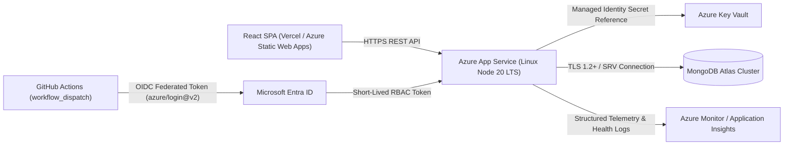

# Azure Deployment Plan & OIDC Workflow Architecture

## 1. Purpose & Assessment Compliance Scope

To satisfy the **Cerevyn PS04 — Azure Support Ticket Automation** assessment requirements while supporting Render and Vercel for rapid student hosting, this repository provides:

1. This complete **Azure Architecture & Operations Plan** (`docs/azure-plan.md`).
2. A **manually triggered (`workflow_dispatch`) GitHub Actions deployment workflow** (`.github/workflows/deploy-azure.yml`) using **OpenID Connect (OIDC) federated credentials** (`azure/login@v2`) instead of long-lived client secrets.

> [!NOTE]
> Live Azure cloud resources have **not** been provisioned during this local assessment build. This document and the accompanying `.github/workflows/deploy-azure.yml` workflow provide the exact production-ready configuration required to deploy the backend API to **Azure App Service (Linux, Node 20 LTS)** connected to **MongoDB Atlas**.

---

## 2. Azure Architecture & Request Flow

### Request Flow in Azure

1. **Client Request**: The React frontend sends HTTPS requests (`GET /api/tickets`, `POST /api/tickets`, `POST /api/tickets/:ticketId/approve`) to `https://<app-name>.azurewebsites.net`.
2. **TLS Termination & Ingress**: Azure App Service front-ends terminate TLS 1.2/1.3 and forward traffic to the internal Node.js container listening on `process.env.PORT` (`0.0.0.0`).
3. **Secret Resolution**: App Service injects environment variables (`MONGODB_URI`, `REVIEWER_API_KEY`, `FRONTEND_ORIGIN`, `CONFIDENCE_THRESHOLD`), referencing sensitive values from **Azure Key Vault** via a **System-Assigned Managed Identity**.
4. **Database Persistence**: The Express API connects to **MongoDB Atlas** over TLS using the `mongodb+srv://` URI, enforcing the unique index on `ticketId`.

---

## 3. Application Hosting & Build Method

- **Compute Service**: **Azure App Service on Linux** (`B1 Basic` tier for dev/staging or `P1v3 Premium` for production), configured with the **Node 20 LTS** runtime stack.
- **Build & Packaging Method**:
  - In `.github/workflows/deploy-azure.yml`, GitHub Actions checks out the repository, installs dependencies (`npm ci`), runs `npm run typecheck` and `npm test`, compiles TypeScript (`npm run build` -> `backend/dist/`), prunes development dependencies (`npm prune --omit=dev`), and deploys the `./backend` directory using `azure/webapps-deploy@v3`.
  - App Service executes `npm start` (`node dist/server.js`), which binds to `0.0.0.0` on the port injected by Azure (`PORT=8080` by default on App Service Linux).
  - Alternatively, the provided multi-stage `backend/Dockerfile` can be pushed to **Azure Container Registry (ACR)** and deployed to **Azure Web App for Containers**.

---

## 4. Identity, OIDC Authentication & Least-Privilege Authorization

Long-lived Azure service principal passwords (`AZURE_CREDENTIALS` JSON secrets) are avoided. Instead, deployment authentication uses **Microsoft Entra ID Workload Identity Federation (OIDC)**:

### Step-by-Step OIDC Setup in Azure

1. **Create a User-Assigned Managed Identity or App Registration** in Microsoft Entra ID.
2. **Assign Least-Privilege RBAC Role**:
   - Scope the role assignment strictly to the target **Resource Group** or the specific **Azure App Service** resource (`/subscriptions/<SUBSCRIPTION_ID>/resourceGroups/<RG_NAME>/providers/Microsoft.Web/sites/<APP_NAME>`).
   - Assign the **`Website Contributor`** role (avoiding broad subscription-wide `Owner` or `Contributor` permissions).
3. **Configure Federated Credential**:
   - **Issuer**: `https://token.actions.githubusercontent.com`
   - **Subject Identifier**: `repo:<github-owner>/<github-repo>:ref:refs/heads/main` (or environment-scoped `repo:<github-owner>/<github-repo>:environment:production`)
   - **Audience**: `api://AzureADTokenExchange`
4. **Configure GitHub Repository Variables** (`Settings -> Secrets and variables -> Actions -> Variables`):
   - `AZURE_CLIENT_ID`: Application (client) ID of the Entra App Registration / Managed Identity.
   - `AZURE_TENANT_ID`: Microsoft Entra Directory (tenant) ID.
   - `AZURE_SUBSCRIPTION_ID`: Target Azure Subscription ID.
   - `AZURE_WEBAPP_NAME`: Name of the target Azure App Service instance.

Because OIDC uses short-lived tokens negotiated via `permissions: id-token: write`, **zero Azure secrets need to be stored in GitHub Secrets**.

---

## 5. Environment Configuration & Secret Management

Configure the following Application Settings on the Azure App Service instance:

| Setting Name | Source | Description |
| :--- | :--- | :--- |
| `NODE_ENV` | App Setting | `production` |
| `PORT` | App Setting | Injected automatically by App Service (`8080`) |
| `FRONTEND_ORIGIN` | App Setting | Exact HTTPS origin of the deployed Vercel frontend (e.g., `https://your-app.vercel.app`) |
| `CONFIDENCE_THRESHOLD` | App Setting | `0.45` |
| `MONGODB_URI` | Azure Key Vault Reference | `@Microsoft.KeyVault(SecretUri=https://<vault>.vault.azure.net/secrets/MongoDbUri/)` |
| `REVIEWER_API_KEY` | Azure Key Vault Reference | `@Microsoft.KeyVault(SecretUri=https://<vault>.vault.azure.net/secrets/ReviewerApiKey/)` |
| `SCM_DO_BUILD_DURING_DEPLOYMENT` | App Setting | `false` (since TypeScript is pre-compiled and pruned in GitHub Actions) |

Grant the App Service's **System-Assigned Managed Identity** the **`Key Vault Secrets User`** RBAC role on the Azure Key Vault instance so only the running App Service can read `MONGODB_URI` and `REVIEWER_API_KEY`.

---

## 6. Database Connectivity & CORS

- **MongoDB Atlas Network Security**:
  - Retrieve the **Outbound IP Addresses** (`outboundIpAddresses` and `possibleOutboundIpAddresses`) of the Azure App Service from the Azure Portal (*Networking -> Outbound Traffic*) and add them to the **MongoDB Atlas IP Access List**.
  - For higher security on dedicated tiers (`M10+`), configure **Azure Private Link** between the App Service VNet Integration subnet and MongoDB Atlas.
- **CORS Policy**:
  - `backend/src/app.ts` restricts browser cross-origin requests to the comma-separated origins listed in `FRONTEND_ORIGIN`.

---

## 7. Health Checks, Logging, Monitoring, Failure Handling & Rollback

- **Health Check Probe**:
  - Configure Azure App Service **Health Check** path to `/api/health`.
  - When MongoDB is connected, `/api/health` returns `HTTP 200 {"status": "healthy"}`. If MongoDB connectivity drops, it returns `HTTP 503 {"status": "degraded"}`, allowing App Service to detect unhealthy instances and route traffic away.
- **Logging & Monitoring**:
  - Enable **App Service Diagnostic Logs** (Application Logging & HTTP logs streamed to **Azure Log Analytics Workspace**).
  - Attach **Azure Application Insights** for request latency percentiles, HTTP 4xx/5xx alert rules, and dependency tracking.
  - All backend database connection error logs scrub connection credentials (`mongodb://<redacted>@`) and never log `x-reviewer-api-key` headers.
- **Rollback Strategy**:
  - Use **Azure App Service Deployment Slots** (`staging` slot $\rightarrow$ smoke test `/api/health` $\rightarrow$ swap with `production` slot), or re-trigger `.github/workflows/deploy-azure.yml` from a known-good Git commit tag.

---

## 8. Cost-Control Assumptions & Comparison with Render Deployment

- **Cost-Control Assumptions**:
  - Using Azure App Service Linux `F1 Free` or `B1 Basic` ($\approx \$13/\text{month}$, often covered by Azure for Students credits) alongside MongoDB Atlas `M0 Free Tier` keeps infrastructure cost near $\$0$.
- **How Azure Differs from the Render Deployment**:
  - **Render (`render.yaml`)**: Connects directly to GitHub via Render's native integration, builds from `backend/`, stores secrets in Render Environment Variables, and runs on Render's managed container PaaS.
  - **Azure App Service (`deploy-azure.yml`)**: Uses explicit GitHub Actions CI/CD with OIDC federated identity (`azure/login@v2`), supports Azure Key Vault Managed Identity secret references, and integrates with Azure Monitor / Application Insights.
